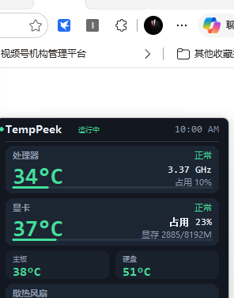
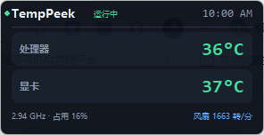
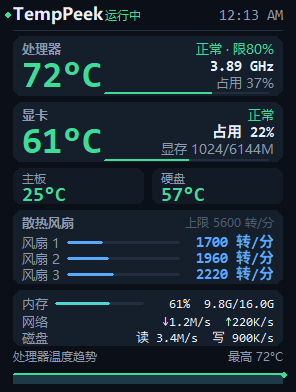

# TempPeek

一个 Windows 桌面悬浮硬件监控面板：常驻置顶、可拖动、只读、不联网。


> 下载：[Releases](https://github.com/XiaoShips/tempeek/releases) 里的安装包 `TempPeek-Setup-v2.2.1.exe` 或便携版 `TempPeek-v2.2.1-portable.zip`

| 完整模式 | 迷你模式 |
| :-: | :-: |
|  |  |

面板上的数字全部来自本机硬件实时读数，不是演示数据（截图为 Dell G3 3590 实拍）。

## 下载与运行

去 [Releases](https://github.com/XiaoShips/tempeek/releases) 取对应版本（当前 v2.2.1），两种包功能完全一致：

- **安装版（推荐日常使用）**：下载 `TempPeek-Setup-v2.2.1.exe`，一路下一步，装到 `C:\Program Files\TempPeek\`，桌面和开始菜单都会生成快捷方式，可设开机自启。
- **便携版（免安装 / 绿色）**：下载 `TempPeek-v2.2.1-portable.zip`，解压后**根目录直接就是 `TempPeek.exe`**——双击即可运行，无需进入任何子文件夹，也不写注册表、不留卸载项；「卸载」就是直接删掉整个解压目录。适合 U 盘随身、临时机器或多用户共享。

> 两种方式都只读取传感器数据、不联网（唯一联网动作是「检查更新」且只访问 GitHub）。
> 便携版的路径里不要含中文或空格，否则部分驱动/提权逻辑可能异常。

## 功能

- **处理器**：温度、实时频率、占用率；设了频率上限时徽章会标出 `限 xx%`
- **显卡**：温度、占用率、显存已用 / 总量
- **主板与硬盘**：Super I/O 主板温度、NVMe / SATA 硬盘 SMART 温度
- **散热风扇**：**数量自动探测（1–6 路）**，面板高度随风扇数量伸缩；未接线的空接口不会伪装成“风扇 2”
- **系统**：内存占用、网络上下行、磁盘读写速率
- **趋势**：处理器温度曲线，带最高温标记
- **CPU 频率上限**：右键菜单一键限频（50–100%），随时恢复 100%
- **版本更新**：从本仓库 `version.json` 检查新版本，下载 → 备份 → 原子替换，重启生效

## 使用方法

- **左键拖动**移动面板，位置会自动记住
- **双击**在完整模式和迷你模式之间切换
- **右键**打开菜单：刷新间隔、不透明度、置顶、温度平滑、CPU 频率上限、版本更新、立即刷新、退出
- **`Esc`** 退出
- 单实例：重复启动只会把已有面板提到前台
- 偏好保存在 `%USERPROFILE%\.tempeek.json`，删掉即恢复默认

## 机型适配

面板不绑定具体机型，按下面的顺序逐级降级：

| 优先级 | 温度 / 风扇通道 | 适用 | 说明 |
| :-: | --- | --- | --- |
| 1 | 戴尔 AWCC WMI（`root\WMI` → `AWCCWmiMethodFunction`） | 戴尔笔记本 / 部分台式机 | 装了 AWCC 或 Alienware Command Center 就有 |
| 2 | LibreHardwareMonitorLib + PawnIO | 任意 x64 机器 | 需 `tools/lhm/sensors.exe` 与 PawnIO 驱动 |
| 3 | sysfs 级别的系统接口 | 全平台 | GPU 走 `nvidia-smi`，硬盘走 SMART，主板走 ACPI 热区 |

**风扇怎么数出来的**：AWCC 的风扇接口是一组 ID（`0x30`–`0x3F`），启动时逐个用 `0x05` 读一次转速——
无效 ID 恒返回哨兵值 `0xFFFFFFFF`，有效 ID 返回真实转速（停转时返回 `0`，仍算存在）。
两个保守兜底避免在非戴尔机器上“编造”风扇：一个都探不到、或探到的比 6 路还多（说明固件对所有 ID 都回 0，
分不清真假）时，退回传统的 `0x32` / `0x33` 双风扇表。

实测（Dell G3 3590）：`0x03` 枚举对任何参数都返回 `0x32`、`0x06` 百分比恒为 `0xFFFFFFFF`、
`0x09` 最大值对无效 ID 也返回 5600，这三条都不能用来发现风扇，只有 `0x05` 可以。

面板高度按风扇数量自动伸缩，双风扇时与旧版逐像素一致：

| 风扇数 | 1 | 2 | 3 | 4 | 6 |
| :-: | :-: | :-: | :-: | :-: | :-: |
| 完整模式高度 | 360 | **376** | 392 | 408 | 440 |

| 三风扇排版（示意，数据为构造值） |
| :-: |
|  |

## CPU 频率上限

右键菜单 → **CPU 频率上限**，可选 100 / 95 / 90 / 85 / 80 / 70 / 60 / 50%，也能输入任意 50–100 的整数。

- 通过 Windows 电源计划的 `PROCTHROTTLEMAX`（最大处理器状态）实现，同时写交流与直流两套值并回读校验；
- 这是**系统级持久设置**，重启后仍生效；选「恢复默认（100%）」即刻恢复全速睿频；
- 不改最小处理器状态、不写倍频、不改 BIOS、不做 undervolt；
- 需要管理员权限，写入失败时标题栏会红字提示原因并回读真实值。

## 版本更新

右键菜单 → **版本更新**。两种运行形态都能一键完成，不需要手动去 Releases 下载：

- 默认更新源为本仓库（`XiaoShips/tempeek`），可在菜单里改成自己的 `owner/repo`；
- 优先读仓库根目录的 `version.json`（无 API 限流），失败时回退到 Releases 最新 tag；
- 候选地址依次尝试：`version.json` 里的 `zip` 字段 → 约定的 Release 资产 → Releases API，
  任一处 404 会自动换下一个，不会一次失败就中断。

**源码版**（`python tempeek.py`）：下载新的 `tempeek.py`，做长度、内容、语法三重校验，
备份为 `tempeek.py.bak` 后 `os.replace` 原子替换。

**安装版 / 便携版**（`TempPeek.exe`）：下载约 16 MB 的整包 zip → 解压到临时目录 →
校验包内 `TempPeek.exe` 的 PE 头与体积 → 生成替换脚本 → 面板自动退出 → 覆盖安装目录 →
自动重新启动。细节：

- 正在运行的 exe 无法直接覆盖，脚本先把旧 exe 改名为 `TempPeek.exe.old` 再落新文件，
  替换成功后删除 `.old`；
- 只覆盖不删除：`unins000.exe` 等卸载器文件、你放进去的其它文件都不会被清掉；
- 复制失败（文件仍被占用）会自动重试，最多约 80 秒；
- 整个过程写日志到 `%TEMP%\tempeek-update.log`，替换脚本本身在 `%TEMP%\tempeek-update-*`；
- 不碰 `~/.tempeek.json` 与快捷方式，更新后配置照旧。

若安装目录不可写（例如装在 `Program Files` 但以非管理员运行），会提示先以管理员身份运行。

## 驱动与管理员权限

读取 MSR 与主板 Super I/O 需要驱动，因此：

1. 戴尔机型：装好 AWCC / Alienware Command Center 即可，无需额外驱动；
2. 其他机型：安装 [PawnIO](https://pawnio.eu)（namazso 签名的开源内核驱动，可在“设置 → 应用”里单独卸载），
   并把编译好的 `tools/lhm/sensors.exe` 放到脚本目录下（见 [tools/lhm/README.md](tools/lhm/README.md)）；
3. 启动时允许管理员权限（非管理员会用 UAC 静默提权重启一次）。

没有驱动或被拒绝提权时，面板仍能显示频率、占用、显存、内存、网络、磁盘这些系统级数据，
温度与风扇一栏显示 `--`，状态栏提示“部分数据不可用”。

## 数据来源与优先级

| 项目 | 来源 | 备注 |
| --- | --- | --- |
| CPU / GPU 温度、风扇转速 | 戴尔 AWCC WMI，缺失时用 LHM | 需管理员；都不可用时显示 `--` |
| 主板温度 | LHM Super I/O，缺失时用 ACPI 热区 | 笔记本 ACPI 热区常为固定环境温度 |
| 硬盘温度 | LHM，缺失时用 WMI `Get-StorageReliabilityCounter` | 兜底路径有限流，约 45 秒一次 |
| GPU 温度 / 占用 / 显存 | `nvidia-smi`，温度回退到 AWCC 或 LHM | AMD / Intel 显卡只有温度 |
| CPU 频率 / 内存 / 网络 / 磁盘 IO | psutil + Windows 性能计数器（PDH） | 频率按 `% Processor Performance × 基频` 还原睿频 |

## 隐私与安全

- 只读取传感器数据，**不写**风扇曲线、不改变压、不切换散热档位。
- **不联网**：唯一主动发起的网络请求是「检查更新」，且只访问 GitHub；不上传任何遥测。
- 涉及系统改动的只有两处，都需用户主动触发：可选的 PawnIO 驱动安装、右键菜单里的 CPU 频率上限。
- 更新只替换主程序并留 `.bak` 备份，替换前做语法编译校验，不会执行下载内容。

## 已知限制

- 需要 Windows 10 / 11 64 位与管理员权限。
- 核显机器没有独立显卡温度；无风扇设备没有转速读数——属于硬件本身不上报。
- 风扇一栏最多显示 6 路；真风扇停转时仍显示 `0 转/分`。
- CPU 频率上限是电源计划级设置，会影响整机而不只是面板显示；笔记本插电/电池分别生效（两者都会写）。
- 安装包未购买代码签名，SmartScreen 可能提示“未知发布者”，点“更多信息 → 仍要运行”即可；部分杀毒软件会对 PyInstaller 打的包误报。
- 在 Dell G3 3590（i7-9750H + GTX 1660 Ti Max-Q）上实测；其他机型按上表逐级降级。

## 常见问题

**状态显示“部分数据不可用”** —— 多为没装 AWCC / PawnIO 或拒绝了管理员权限，装好驱动或以管理员身份启动。

**状态显示“降级(...)”** —— 厂商通道和 LHM 都没起来，只显示系统级数据；括号里是原因。

**显卡占用 / 显存显示 `--`** —— 这两项来自 NVIDIA 驱动自带的 `nvidia-smi`，AMD / Intel 显卡只能显示温度。

**只列出一个风扇 / 列出的风扇数和机器不一样** —— 面板只显示真正存在的转速接口；Super I/O 上未接线的输入口恒为 0，不会被算作风扇。机器确实有 2 个风扇却只显示 1 个时，多半是那一路当前未接线或固件没上报。

**设了频率上限后频率明显变低** —— 这是预期行为：`PROCTHROTTLEMAX` 直接压低最大处理器状态，选「恢复默认（100%）」即可。

**升级安装时提示面板正在运行** —— 先在面板右键菜单选“退出”，再运行新安装包。

## 从源码运行

```bash
# Python 3.11（自带 tkinter）
pip install -r requirements.txt
python tempeek.py
```

戴尔机型不需要 `tools/lhm/`；其他机型按 [tools/lhm/README.md](tools/lhm/README.md) 放置 `sensors.exe`。

## 打包与发布

```powershell
pip install pyinstaller
pyinstaller -F -w -n TempPeek --icon panel.ico tempeek.py
```

发布新版本时：改 `tempeek.py` 的 `APP_VER` → 同步 `version.json` 的 `version` 与 `date` → 打 tag → 上传安装包。

## 版本历史

见 [CHANGELOG.md](CHANGELOG.md)；通用化改造的逐项说明见 [docs/改动说明.md](docs/改动说明.md)。

## 第三方组件

二进制分发涉及的 LibreHardwareMonitorLib、HidSharp、PawnIO、Python / Tcl-Tk / psutil / pywin32 等的许可证与源码地址见 [THIRD_PARTY_NOTICES.md](THIRD_PARTY_NOTICES.md)。

## 致谢

- [LibreHardwareMonitor](https://github.com/LibreHardwareMonitor/LibreHardwareMonitor) —— 传感器读取
- [PawnIO](https://github.com/namazso/PawnIO) —— 内核驱动
- [TrafficMonitor](https://github.com/zhongyang219/TrafficMonitor)、[LiteMonitor](https://github.com/Diorser/LiteMonitor) —— 桌面悬浮窗交互上的参考

## 声明

本仓库的 Releases 是该面板**唯一**的官方分发渠道，没有官网、网盘或第三方下载站。本项目与 LibreHardwareMonitor、PawnIO、Dell 均无隶属关系。安全相关问题请按 [SECURITY.md](SECURITY.md) 联系。

## License

[MIT](LICENSE)（本项目自身代码）。随包分发的第三方组件仍受各自许可证约束。
